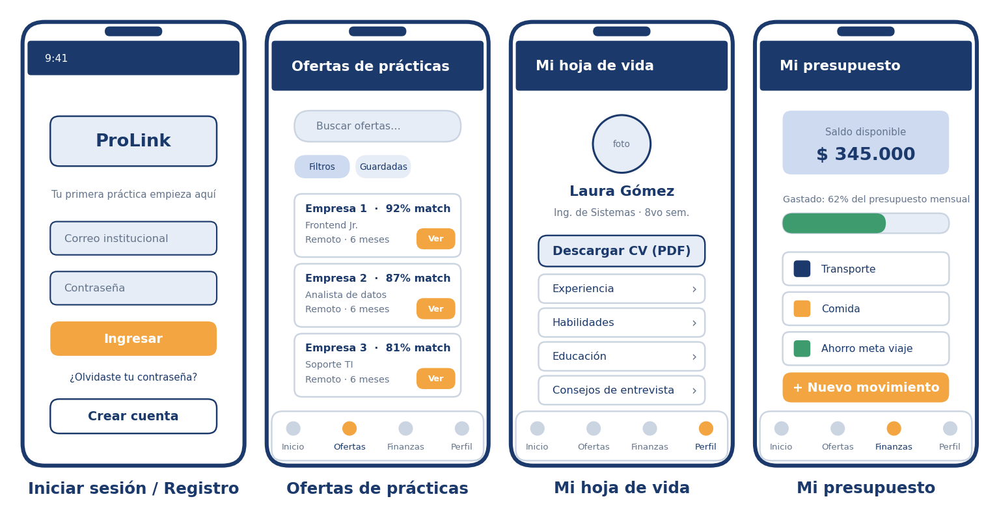
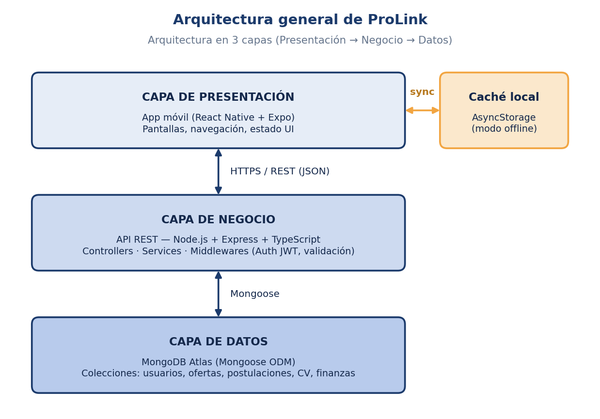
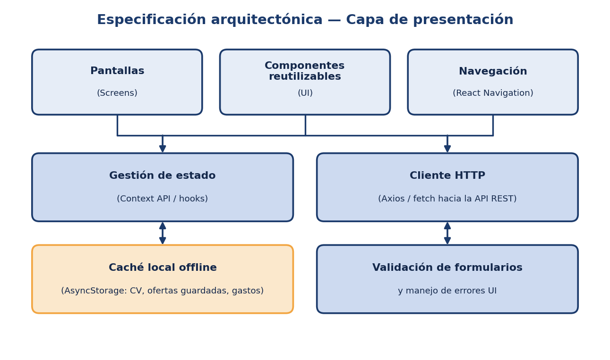
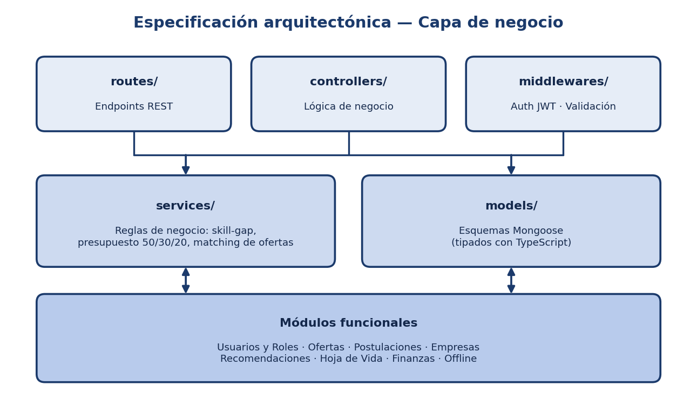
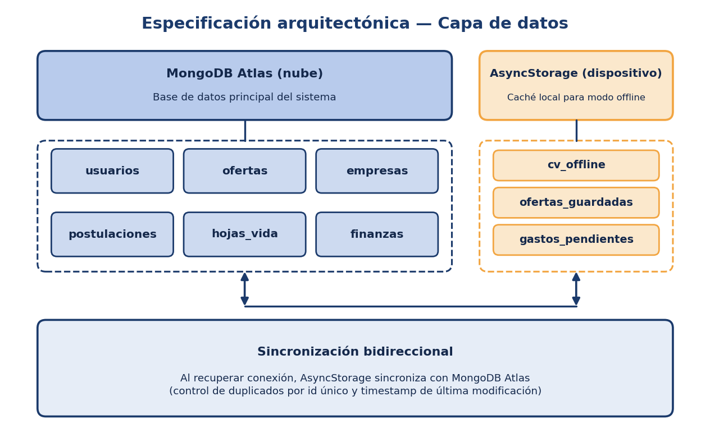
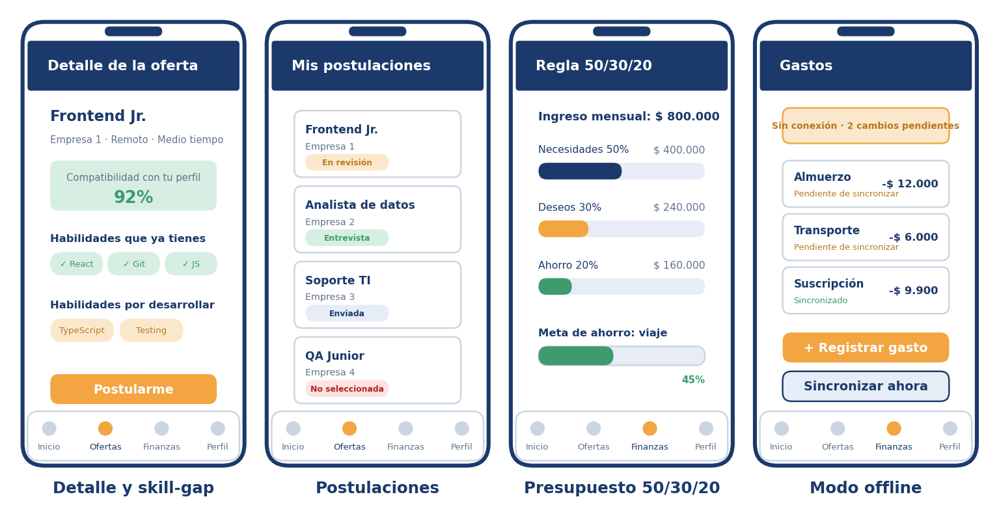
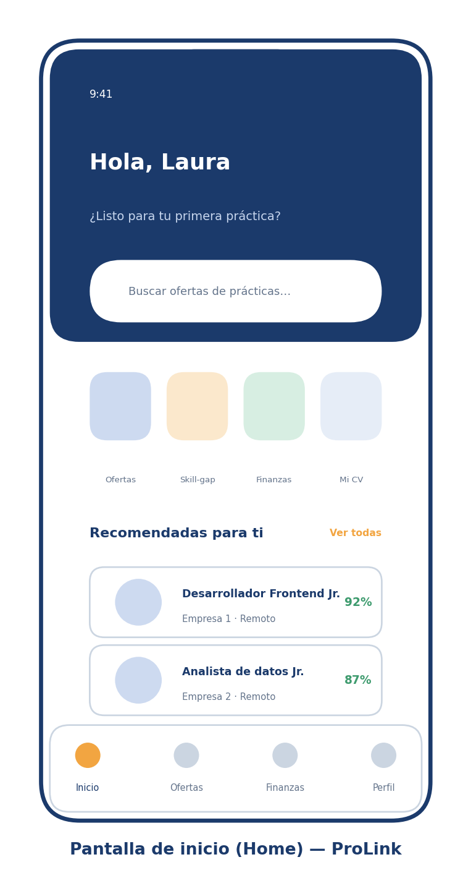
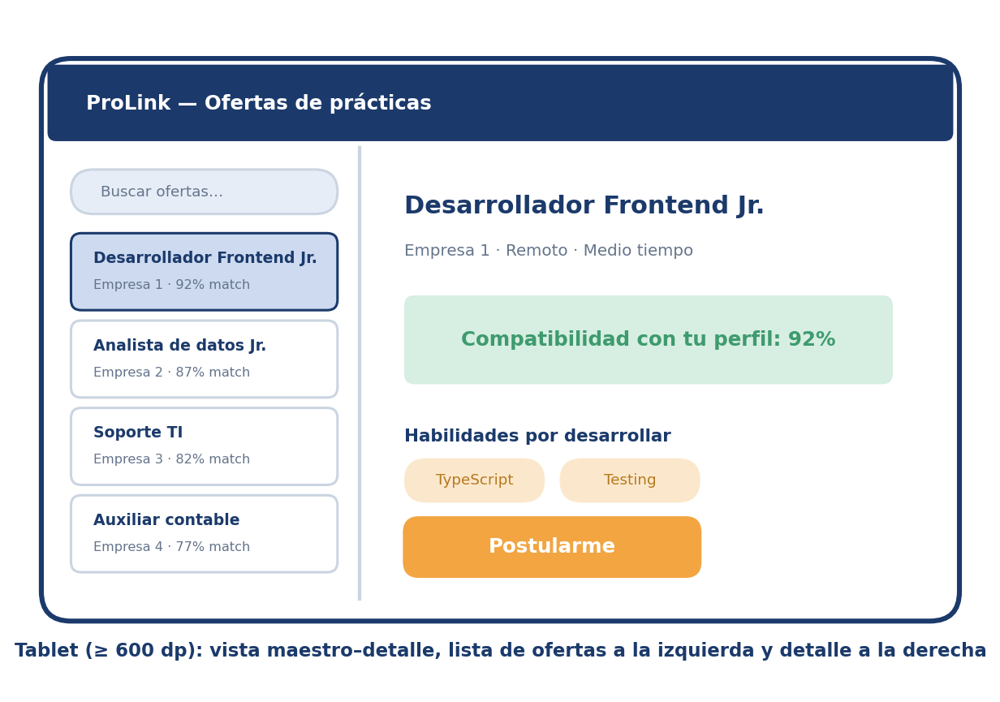

# ProLink

**Portal móvil de empleabilidad, desarrollo de habilidades y finanzas personales para estudiantes universitarios**

*Programación en Dispositivos Móviles II · Ingeniería de Sistemas · UNIAJC (Cali) · 2026-2*

## Tabla de contenido

[Problema](#-problema) · [Qué ofrece](#-qué-ofrece) · [Módulos](#-módulos) · [Arquitectura](#-arquitectura) · [Mockups](#-mockups) · [Requerimientos no funcionales](#-requerimientos-no-funcionales) · [Proceso y roadmap](#-proceso-y-roadmap) · [Equipo](#-equipo) · [Documentación](#-documentación)

## 🎯 Problema

Quien busca su primera práctica profesional enfrenta tres dificultades:

1. **Ofertas dispersas:** los portales genéricos no filtran por carrera, semestre o modalidad.
2. **Brecha de habilidades invisible:** no es fácil saber qué habilidades técnicas faltan frente a lo que pide el mercado.
3. **Finanzas durante la práctica:** muchas prácticas son no remuneradas o con auxilio bajo, y no hay herramientas simples para organizar ingresos y gastos.

ProLink resuelve las tres necesidades desde una sola aplicación móvil.

## ✨ Qué ofrece

| Pilar | Descripción |
|---|---|
| **Empleabilidad** | Hoja de vida, búsqueda y filtrado de ofertas de prácticas, guardado y postulación con seguimiento de estado. |
| **Habilidades (skill-gap)** | Compatibilidad entre el perfil y cada oferta, con las habilidades que ya tienes y las que te faltan por desarrollar. |
| **Finanzas** | Ingresos, gastos, presupuesto mensual con la regla **50/30/20**, metas de ahorro e historial. |
| **Modo offline** | CV, ofertas guardadas y gastos pendientes disponibles sin conexión, con sincronización automática y sin duplicados. |

## 🧩 Módulos

El backlog está organizado en **8 épicas** y **32 historias de usuario** en Jira (proyecto PRL).

| Épica | Módulo | Descripción | HU |
|---|---|---|:-:|
| EPIC-01 | Gestión de Usuarios y Roles | Registro, autenticación y perfil del estudiante | 5 |
| EPIC-02 | Ofertas de Prácticas | Consulta, búsqueda, filtrado y guardado de ofertas | 5 |
| EPIC-03 | Postulaciones | Postulación y seguimiento de su estado | 3 |
| EPIC-04 | Empresas | Información de las empresas que publican ofertas | 1 |
| EPIC-05 | Recomendaciones | Recomendación según perfil, carrera y habilidades | 1 |
| EPIC-06 | Hoja de Vida | Construcción, edición y descarga del CV | 5 |
| EPIC-07 | Finanzas y Presupuesto | Ingresos, gastos, presupuesto, metas e historial | 9 |
| EPIC-08 | Modo Offline | Acceso y registro sin conexión con sincronización | 3 |

**Fuera de alcance en esta versión:** mensajería estudiante–empresa, publicación de ofertas por parte de las empresas desde la app (hoy se administran desde el backend) y reportes financieros avanzados (proyecciones, exportación a Excel).

## 🏗️ Arquitectura

Arquitectura en **3 capas** (presentación → negocio → datos), con caché local para el modo offline.

| Capa | Tecnología |
|---|---|
| Presentación | React Native + Expo SDK 58, Expo Router, Context API / hooks |
| Negocio | Node.js + Express + TypeScript, patrón MVC (`routes`, `controllers`, `services`, `models`, `middlewares`) |
| Datos | MongoDB Atlas (Mongoose) + AsyncStorage como caché offline |
| Seguridad | JWT para sesiones, contraseñas cifradas con bcrypt |

<b>Ver el detalle de cada capa</b>

Decisión de diseño documentada: [ADR-0001 · MongoDB Atlas como base de datos única](docs/adr/0001-mongodb-como-base-de-datos-unica.md).

## 📱 Mockups

<table align="center">
<tr>
<td align="center"> Pantalla de inicio</td>
<td align="center"> Tablet (≥ 600 dp): lista a la izquierda, detalle a la derecha</td>
</tr>
</table>

## ✅ Requerimientos no funcionales

| Requerimiento | Descripción |
|---|---|
| Multiplataforma | Android e iOS desde una única base de código |
| Rendimiento | API REST < 2 s; listado de ofertas < 3 s |
| Usabilidad | Postulación en máximo 3 pasos desde el detalle de la oferta |
| Responsivo | Teléfonos y tablets |
| Offline | CV, ofertas guardadas y gastos pendientes sin conexión; sincronización sin duplicados |
| Seguridad | JWT + bcrypt |
| Escalabilidad | Backend reemplazable o escalable sin afectar la capa de presentación |
| Disponibilidad | Modo degradado (offline) sin pérdida de información |

## 🗓️ Proceso y roadmap

Scrum con sprints de dos semanas (Planning, Daily 3 veces por semana, Review y Retrospectiva). Planeación preliminar:

| Sprint | Épicas | Responsable principal |
|---|---|---|
| 1 | EPIC-01 Usuarios y Roles | Ronaldo Castro |
| 2 | EPIC-02 Ofertas + EPIC-04 Empresas | Ángel A. Angulo |
| 3 | EPIC-03 Postulaciones + EPIC-05 Recomendaciones | Ronaldo Castro / Ángel A. Angulo |
| 4 | EPIC-06 Hoja de Vida | N. Sebastián Ampudia |
| 5 | EPIC-07 Finanzas y Presupuesto | Edwin A. Carabalí |
| 6 | EPIC-08 Modo Offline + QA final | N. Sebastián Ampudia / Edwin A. Carabalí |

## 👥 Equipo

| Integrante | Rol Scrum | Responsabilidad |
|---|---|---|
| **Ángel A. Angulo** | Product Owner · Frontend | Backlog, Ofertas, Empresas y Recomendaciones; UI/UX |
| **Ronaldo Castro** | Scrum Master · Backend | API REST; Usuarios y Postulaciones |
| **Edwin A. Carabalí** | DevOps · DBA · Fullstack | CI/CD, modelado en MongoDB Atlas; Finanzas y Presupuesto |
| **N. Sebastián Ampudia** | QA · Frontend | Pruebas y criterios de aceptación; Hoja de Vida y Offline |

Docente: **Leidy Johanna Carvajal** · Institución Universitaria Antonio José Camacho (UNIAJC), Cali.

## 📚 Documentación

- [Taller 1 — Sprint 0, Requerimientos y Diseño de Software (PDF)](docs/Taller1_ProLink.pdf)
- [Propuesta de proyecto, formato APA 7 (DOCX)](docs/ProLink_Propuesta_APA7.docx)
- [ADR-0001 — Base de datos única](docs/adr/0001-mongodb-como-base-de-datos-unica.md)
- [App móvil — instalación, modo demo y conexión con la API](mobile/README.md)
- Gestión del backlog: Jira, proyecto **PRL**

> La propuesta inicial contemplaba SQLite en el cliente; el Taller 1 la reemplaza por MongoDB Atlas + AsyncStorage (ver ADR-0001).